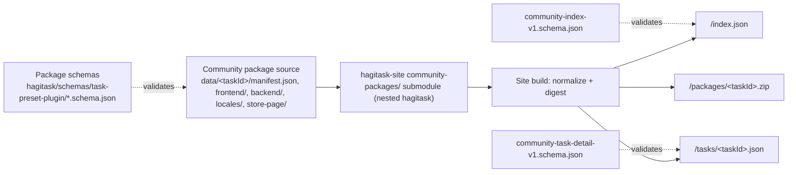

# hagitask

HagiTask is the canonical repository for preset-task contribution assets inside the
HagiCode monorepo. It is the maintained source of truth for shipped preset-task
schemas and preset packages.

## npm CLI

The repository is also published as `@hagicode/hagitask` (Node.js 24 or newer).
Install it with `npm install --save-dev @hagicode/hagitask`, then validate a
repository or one package:

```bash
npx hagitask validate .
npx hagitask validate ./data/my-task --json
```

Create a new package scaffold without network access:

```bash
npx hagitask new my-task
npx hagitask new my-task --target ./data/my-task --repository repos/web repos/hagicode-core
```

The target directory must be empty (or absent), and package names use lowercase
letters, numbers, and hyphens. `--target` selects the exact package directory (its final directory name must match the package name);
`--destination` and `--output` are aliases. `--repository` may be repeated or
followed by multiple identifiers and only populates the repository selector
options; commands still require an explicit `targetRepositories` selection.

Generated packages contain `manifest.json`, `frontend/`, `backend/`, bilingual
`locales/`, `store-page/`, and `commands/README.md`. The baseline commands
`what is this` explain a selected repository, while `what is next` recommends
improvements. Add command definitions in `frontend/commands.json` and matching
localized prompt files in `backend/templates/<locale>/commands/`.

`validate` discovers packages directly under `presets/` and `data/`, or validates
a directory containing `manifest.json`. It returns exit code `0` only when all
discovered packages pass. Human-readable diagnostics are printed by default;
`--json` prints the stable `{ packages, errors, valid }` result on stdout for CI.
Validation reads `schemas/` shipped inside the npm package (and never requires a
network connection). The CLI is the new reusable validator; Contrib and Community
Packages retain their existing workflows until a separate migration.

> Authoring location: contributors add and update preset-task packages **here**, in
> `repos/hagitask`, not in `repos/hagicode-core/src/PCode.Web/plugins/task-presets/`.
> The `hagicode-core` copy is a transitional asset that is kept only until the backend
> loading cutover lands.

## Repository Layout

```text
repos/hagitask/
  schemas/
    task-preset-plugin/
      manifest.schema.json        # Preset package manifest contract
      panel.schema.json           # Frontend panel definition contract
      commands.schema.json        # Frontend command catalog contract
      locales.schema.json         # Locale bundle contract
      task-preset.schema.json     # Backend task-preset contract
      prompt-package.schema.json  # Backend prompt package contract
      store-page-frontmatter.schema.json  # Store-page frontmatter contract
    community-index-v1.schema.json        # Published /index.json contract
    community-task-detail-v1.schema.json  # Published /tasks/<taskId>.json contract
  presets/
    <presetTaskId>/
      manifest.json
      frontend/
        panel.json
        commands.json             # Optional, only when the preset ships commands
      backend/
        task-preset.json
        prompts.json
        templates/<locale>/...
      locales/
        en-US.json
        zh-CN.json
      store-page/
        index.en-US.md
        index.zh-CN.md
```

## Schema Layers

`schemas/` holds three schema layers. They validate different documents, at different
points in the pipeline, and are owned by different producers.

| Layer | Schemas | Validates | Produced by |
| --- | --- | --- | --- |
| Package schemas | `schemas/task-preset-plugin/*.schema.json` | the JSON files inside a preset or community package (`manifest.json`, `frontend/*`, `backend/*`, `locales/*`) | contributors, by hand |
| Community discovery schema | `schemas/community-index-v1.schema.json` | the published `/index.json` catalog | `hagitask-site` build |
| Community detail schema | `schemas/community-task-detail-v1.schema.json` | each published `/tasks/<taskId>.json` document | `hagitask-site` build |

Package schemas describe **authored source**. The community schemas describe
**generated publication output** and carry fields that do not exist in any package file
(`generatedAt`, `detailUrl`, `packageUrl`, `integrity.sha256`, and so on). Choosing the
wrong layer is the most common source of confusion: if you are editing a file inside a
package directory, the matching contract is always under `schemas/task-preset-plugin/`.

Community packages live in
[`hagitask-community-packages`](https://github.com/HagiCode-org/hagitask-community-packages).
That repository mounts HagiTask as a **nested submodule** and consumes these schemas
directly from `hagitask/schemas/task-preset-plugin/` — it no longer vendors its own copy.
[`hagitask-site`](https://github.com/HagiCode-org/hagitask-site) in turn mounts the
community repository as its `community-packages/` submodule, reads task packages from
`community-packages/data/`, and loads the publication schemas from
`community-packages/hagitask/schemas`. Shipped presets live in `presets/` in this
repository. All three — HagiTask presets, community packages, and the site build — use the
same package schemas from this directory.

## Package `$schema` Reference

`schemas/task-preset-plugin/` is the authoritative home for the JSON schemas that
validate preset packages. Every shipped and community preset package resolves its
`$schema` references against this directory, so contributors never need files from
`repos/hagicode-core` to validate a package.

The shipped preset packages use these relative `$schema` paths from inside
`presets/<presetTaskId>/`:

| Package file                       | `$schema` path                                                          |
|------------------------------------|-------------------------------------------------------------------------|
| `manifest.json`                    | `../../schemas/task-preset-plugin/manifest.schema.json`                 |
| `frontend/panel.json`              | `../../../schemas/task-preset-plugin/panel.schema.json`                 |
| `frontend/commands.json`           | `../../../schemas/task-preset-plugin/commands.schema.json`              |
| `backend/task-preset.json`         | `../../../schemas/task-preset-plugin/task-preset.schema.json`           |
| `backend/prompts.json`             | `../../../schemas/task-preset-plugin/prompt-package.schema.json`        |
| `locales/<locale>.json`            | `../../../schemas/task-preset-plugin/locales.schema.json`               |

Prompt packages may optionally declare `commandSystemPrompts`, mapping a command id
to locale-specific system-template paths:

```json
{
  "commandSystemPrompts": {
    "initialize": {
      "en-US": "./templates/en-US/commands/initialize.md",
      "zh-CN": "./templates/zh-CN/commands/initialize.md"
    }
  }
}
```

The selected command template is rendered with the same context as the user and
base system templates. Locale resolution uses an exact match, then the language
portion, then the package default locale. Missing mappings, blank commands, and
legacy packages simply omit the additional system section. Final prompt order is
user prompt, command-specific system prompt, then base system prompt; existing
command preludes remain supported.

Community packages use the identical values, so a package can move between
`presets/<presetTaskId>/` and the community repository without rewriting references.

## Well-Known Input: `omitNonInteractiveHints`

`omitNonInteractiveHints` is a reserved, optional, boolean system input for prompt
packages. It tells the template whether interactive control is enabled for the agent CLI
that runs the task. A package that wants to follow the switch declares the input in
`backend/prompts.json`:

```json
{
  "name": "omitNonInteractiveHints",
  "source": "system",
  "required": false,
  "description": "Optional. True when interactive control is enabled for the agent CLI running this prompt."
}
```

and gates its run-mode declaration in each template that carries one:

```handlebars
{{#unless omitNonInteractiveHints}}
## Run mode
This prompt is running in a non-interactive environment.
{{/unless}}
```

- **What to gate.** The whole run-mode section: the "non-interactive" declaration, its
  prohibitions of interactive tools or follow-up questions, and the default-choice rules
  written inside it. Keep everything outside that section, including scope boundaries,
  output format, and inline body requirements such as "if details are missing, make a
  reasonable assumption". A statement that the package's own requirements demand (for
  example "do not claim extra skills configuration is required") may stay under an
  `{{else}}` branch with a neutral heading.
- **Absent means today's prompt.** A value that is absent, or `false`, renders exactly the
  prompt that existed before the gate. A package that never references the input renders
  the same way with any value.
- **The backend supplies the value.** The host reads the stored interactive-control entry
  of the agent CLI that runs the task and passes it at render time. It is not a creation
  parameter: package panels, `inputBindings` and create requests must not declare or send it.
  Packages that adopt the input should keep it out of their panel and binding definitions.
- **Wording only.** The switch never changes which runs may ask the user a question. It
  only decides whether the gated run-mode text is rendered.

## Publication Data Flow



How source edits reach the published documents:

| Source change | Affected published fields |
| --- | --- |
| `manifest.json` → `version` | `version` in index and detail |
| `manifest.json` → `owner` | `publisher` in index and detail |
| `backend/task-preset.json` → `requirements` | `requirements` in detail, and the derived `compatibility.agent` / `.skills` / `.cli` in both documents |
| `store-page/index.<locale>.md` → `title` / `summary` | `name`, `summary`, `description`, and `localization.supportedLocales` |
| `store-page/index.en-US.md` → `catalog` / `tags` | `category` and `tags` |
| any file in the package directory | the zip contents, plus `integrity.sha256` in the index and `installation.size` / `installation.sha256` in the detail |

## Generated Output Is Not Editable

`/index.json`, `/tasks/<taskId>.json`, and `/packages/<taskId>.zip` are produced from
scratch on every site build. They are not stored in any repository as editable source and
hand edits are discarded on the next publish. The only way to change a published field is
to change the package file it is derived from.

When schema validation fails:

1. Read which document failed. A `task-preset-plugin` failure points at a package file you
   authored; a `community-index-v1` or `community-task-detail-v1` failure means the site
   build normalized your source into something that violates the publication contract.
2. Fix the source package file. Do not relax `$schema`, delete the `$schema` reference,
   skip validation, or patch the generated output.
3. Re-run the site build to confirm the fix.
4. If the package data is genuinely correct and the schema is wrong, change the schema
   **here**, in this repository, as a deliberate contract change.

## Preset Package Directory

`presets/` is the root for preset-task packages. Each package lives in its own
`presets/<presetTaskId>/` directory and preserves the loader-compatible plugin
package shape (`manifest.json`, `frontend/`, `backend/`, `locales/`, and
`store-page/`). This means the backend can load migrated packages without a
HagiTask-specific adapter.

Currently shipped packages:

- `normal-session`
- `research-investigation`

`agents-md-update`, `goal`, `last30days`, `openspec-spec-compress`, `ponytail`, and
`ui-master` are published as community tasks and live in
[`hagitask-community-packages`](https://github.com/HagiCode-org/hagitask-community-packages),
not in `presets/`.

## Source-of-Truth Ownership

HagiTask owns preset-task schemas and shipped preset packages. When you add a new
preset, update an existing one, or change a schema, do it here.

The legacy copies under `repos/hagicode-core/src/PCode.Web/plugins/task-presets/`
are kept unchanged during the copy-first transition phase. After the later backend
loading cutover (see `openspec/changes/migrate-preset-task-to-hagitask-repo`),
`hagicode-core` will load shipped presets from `repos/hagitask/presets` through the
`TaskPresetPlugins.PresetGroups` configuration and the backend-owned copy will no
longer be the shipped source of truth.

Until that cutover lands, every shipped preset update — including `openspec-spec-compress` —
must keep the `hagicode-core` runtime copy synchronized with the canonical HagiTask package.

## Contributing a Preset Package

HagiTask owns the Schema and shipped preset source. Preset packages use the loader-compatible
layout described above and must keep their JSON resources aligned with
`schemas/task-preset-plugin/`. Validate authored files against those schemas before submitting:

```bash
npm run validate
```

The validator checks every shipped preset, all manifest resource references, package
JSON schemas, prompt template references, and compatibility binding aliases. It is
intentionally package-local so the same command can run in a clean checkout without
depending on Core or site-generated output.

For the user-facing walkthrough covering package creation, locale and store-page resources,
validation, semantic versioning, and Pull Requests, see the
[HagiTask community guide](https://docs.hagicode.com/guides/hagitask/community/). A community
task belongs in
[`hagitask-community-packages`](https://github.com/HagiCode-org/hagitask-community-packages),
not in this repository. This README remains the technical reference for Schema ownership,
preset source data, and the transitional runtime copy.